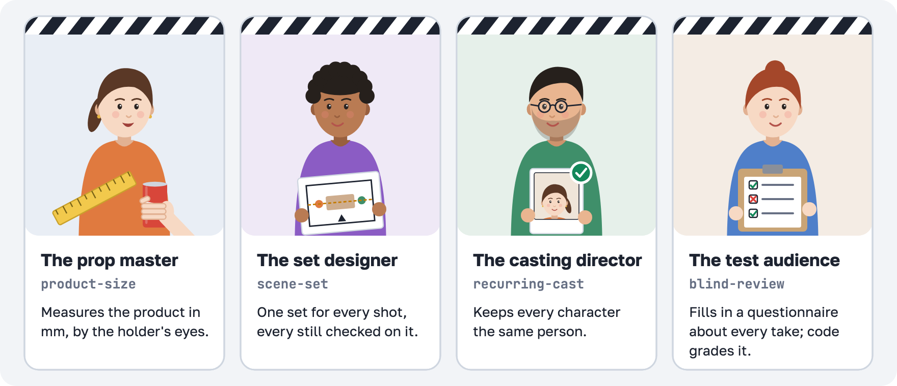
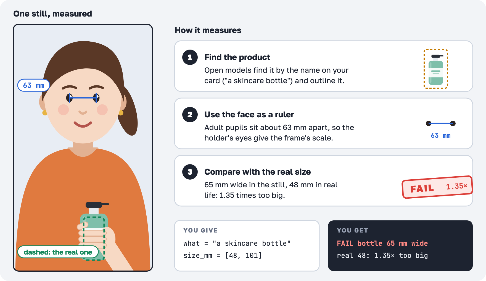
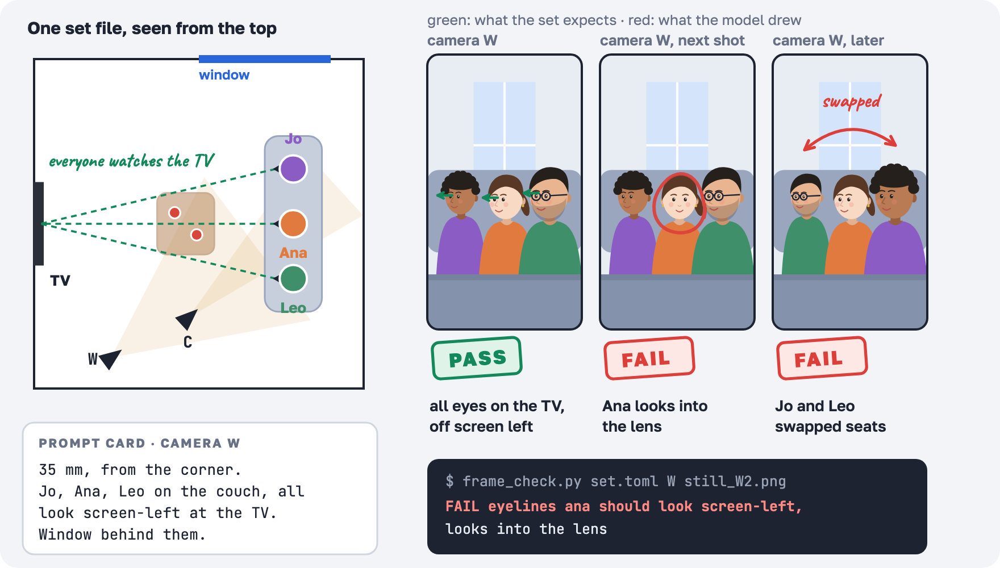
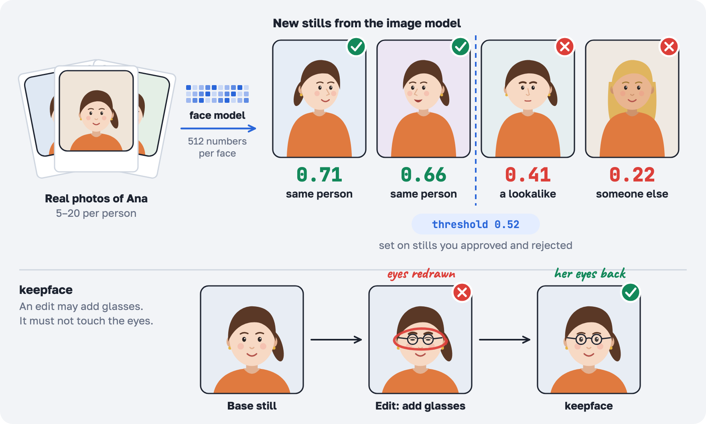
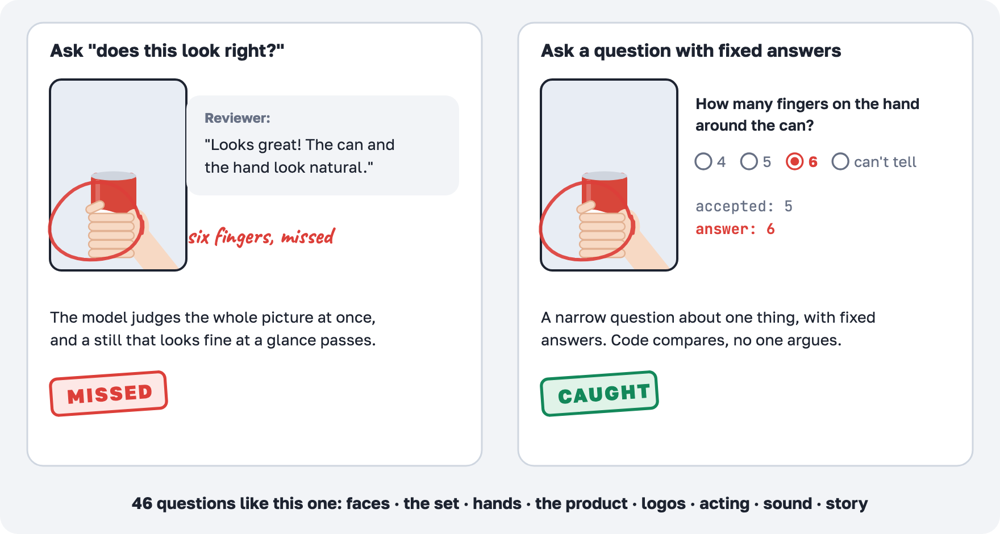

# ai-film-crew

[](https://github.com/Maksim-Burtsev/ai-film-crew/actions/workflows/tests.yml)
[](#install)
[](LICENSE)

**Agent skills that catch what AI video gets wrong, on the stills, before you pay for the video.**



AI video breaks the same way every time. The product comes out a third too big. A face drifts from shot to shot.
The room rearranges itself between angles. Usually the client is the one who notices.

This crew checks every still the way a film crew checks a take, so the defects die at the cheap step. Each skill is
a method your agent reads (`SKILL.md`) and, where eyes aren't enough, a small instrument that measures and prints PASS
or FAIL. It was built over a month of paid AI reels, and every check exists because a defect got past us once.

## Install

In Claude Code:

```
/plugin marketplace add Maksim-Burtsev/ai-film-crew
/plugin install ai-film-crew@ai-film-crew
```

Or copy a skill's folder into `.claude/skills/` in your project, or into `~/.claude/skills/` for every project.

Then ask your agent: "check these stills against the set", or "is the bottle the right size here?". The instruments
are [uv scripts](https://docs.astral.sh/uv/guides/scripts/): they need [uv](https://docs.astral.sh/uv/) and fetch
Python 3.12 and their packages on the first run. Their models download once too; the size check is the heavy one,
with about 1 GB of models and 1 GB of packages.

## The prop master · product-size



Image models draw products too big, and prompts like "a 12 oz can" never hold the size. In our reels a 66 mm can
came out 1.25 to 1.6 times too big, and it changed size between shots.

The instrument finds the product by name, outlines it and measures its width against the pupils of the person
holding it. Adult pupils sit about 63 mm apart, so every face in the frame is a ruler.

- **You give:** the product and its real size: `what = "a skincare bottle"`, `size_mm = [48, 101]`
- **You get:** one PASS or FAIL line per still or shot, and a sheet with the real product at true scale beside it
- **Catches:** a product too big or too small in a hand, a product that grows between shots, a stretched product
- **Misses:** shots with no face (inserts), glass, a box turned edge-on
- **Inside:** [`SKILL.md`](skills/product-size/SKILL.md), [`scripts/size.py`](skills/product-size/scripts/size.py)
  (Grounding DINO, SAM and MediaPipe, all local and free)

## The set designer · scene-set



Prompt each still on its own and the room moves: the table turns, people swap seats, eyelines flip between the wide
and the close-up.

Write the scene once as a set file: the room, the furniture, who sits where and faces whom, one camera per setup.
Every still prompt starts from it, with a text card and a layout image per camera. Every generated still is then
checked against what its camera should see: who is on which side, where they look, whose head is higher, where the
light comes from.

- **You give:** a `set.toml`. The agent writes it with you, or starts from an example: a podcast desk, a round
  podcast table, a couch, a meeting table
- **You get:** a top plan with the 180° line, a prompt card and a layout image per camera, and a verdict per still
- **Catches:** swapped seats, flipped eyelines, faces turned into the lens, wrong heights, light from the wrong side
- **Inside:** [`SKILL.md`](skills/scene-set/SKILL.md), [`scripts/scene.py`](skills/scene-set/scripts/scene.py),
  [`scripts/frame_check.py`](skills/scene-set/scripts/frame_check.py), [`examples/`](skills/scene-set/examples)

## The casting director · recurring-cast



A viewer forgives a lot, but not a face that changes. Image models redraw a person a little in every shot, and edits
quietly redraw the eyes.

Give it a few real photos of the person. A face model turns each face into numbers and compares every new still and
take with the photos. The line between "same person" and "someone else" is set on stills you approved and rejected,
not guessed. When an edit adds glasses or a new pose, keepface puts the original face back and checks that it lines
up.

- **You give:** 5 to 20 photos per person, and a few stills you've judged, to calibrate
- **You get:** a score and a verdict per still or take
- **Catches:** a different person, a face that drifts across shots, eyes redrawn by an edit
- **Face model:** SFace (Apache 2.0) by default. It catches a different person but can miss a close lookalike.
  Stronger models exist, like InsightFace's ArcFace, but their published weights are licensed for non-commercial
  research only: for client work, license one or use a commercial face-comparison service. Check the licence of
  whatever model you use.
- **Inside:** [`SKILL.md`](skills/recurring-cast/SKILL.md),
  [`scripts/identity.py`](skills/recurring-cast/scripts/identity.py),
  [`scripts/keepface.py`](skills/recurring-cast/scripts/keepface.py)

## The test audience · blind-review



The agent that made a still will tell you it looks great. So it never grades its own work.

A fresh agent that never saw the prompt gets the frames and a questionnaire with fixed answers plus "can't tell".
Code compares the answers with the accepted ones, and one wrong answer sends the piece back before a person sees it.
Models are bad at "does this look right?" and decent at "how many fingers are on that hand?", so the reviewer answers
facts and code decides.

- **You give:** nothing. The agent picks the questions for each piece from a bank of 46
- **You get:** a verdict per question, with the tile or second it's about
- **Covers:** faces, people and the set, hands and props, the product, logos and text, acting and motion, sound on
  picture, the edit and the story
- **Inside:** [`SKILL.md`](skills/blind-review/SKILL.md),
  [`references/checklist.md`](skills/blind-review/references/checklist.md),
  [`scripts/grade.py`](skills/blind-review/scripts/grade.py)

## How the checks were tested

Each instrument was lifted out of a production pipeline and run against the original on private golden cases:
frames and takes that once reached a client, and approved ones. `frame_check.py` gave the same verdicts on all 7,
`size.py` on all 9 (within 1 mm), and `identity.py` with ArcFace reproduced the original scores exactly. The golden
files are client material, so they stay private. The tests in [`tests/`](tests) cover everything that needs no
models and run on every push.

## The crew grows

Next on set: the sound mixer (`sound-mix`), the editor (`reel-edit`), the voice coach (`voice-takes`) and the line
producer (`spend-cap`).

## Contributing

Bring a lesson (one line, and how it was proven), a golden case (a frame, and the line a check must print for it),
or a new check (it prints PASS or FAIL, reads only your files and comes with a test). See
[CONTRIBUTING.md](CONTRIBUTING.md).

## Licence

[MIT](LICENSE). The models the instruments download are separate works with their own licences, named in each
script.
